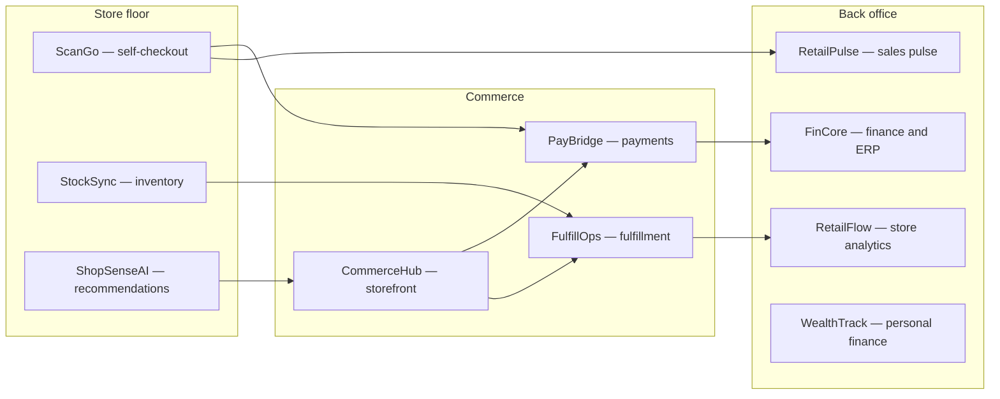

<!-- Publish this as the org profile README: create repo `gopichand-retail-apps/.github`, add `profile/README.md` with this content. -->
# Gopichand Retail Apps

**Retail software portfolio by [Gopichand Chikoti](https://github.com/gopichandchikoti)** — Senior Full Stack Developer (React, TypeScript, Next.js, Node.js, Java / Spring Boot)

10 retail systems, each with a separate frontend and backend repository — modelled on real store operations work: inventory, checkout, fulfilment, payments, and store dashboards.

🌐 Full portfolio with live demos: https://gopichandchikoti-portfolio.vercel.app/
📍 Atlanta, Georgia

## The systems

| System | What it does | Stack | Live demo |
|---|---|---|---|
| StockSync | Inventory visibility across store + warehouse | TypeScript, Node.js, React | https://stocksync-frontend-sand.vercel.app/ |
| ScanGo | Scan-as-you-shop checkout | TypeScript, React | https://scango-frontend.vercel.app/ |
| ShopSenseAI | AI-assisted product search & recommendations | TypeScript, LLM APIs | — |
| CommerceHub | Catalog, cart & order services | Java, Spring Boot, TypeScript | — |
| PayBridge | Payment orchestration | Java, Spring Boot, TypeScript | https://paybridge-frontend-lac.vercel.app/ |
| FulfillOps | Picking, packing & shipping workflow | TypeScript, Node.js, React | https://fulfillops-frontend.vercel.app/ |
| RetailPulse | Sales & store performance dashboards | TypeScript, React | https://retailpulse-frontend-pi.vercel.app/ |
| RetailFlow | Store ops: receiving to replenishment | TypeScript, Node.js, React | https://retailflow-frontend-alpha.vercel.app/ |
| FinCore | Reconciliation & ledger APIs | Java, Spring Boot, TypeScript | https://fincore-frontend-tau.vercel.app/ |
| WealthTrack | Personal spending & savings tracker | TypeScript, React | https://wealthtrack-frontend-eight.vercel.app/ |

## How the systems fit together

## Note
These are portfolio builds, not Tractor Supply / NCR Voyix / U.S. Bank production code.
