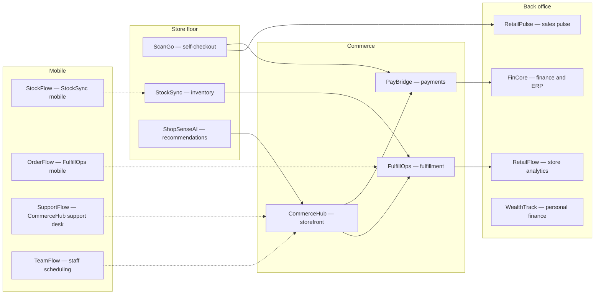

<!-- Publish this as the org profile README: create repo `gopichand-retail-apps/.github`, add `profile/README.md` with this content. -->
# Gopichand Retail Apps

**Retail software portfolio by [Gopichand Chikoti](https://github.com/gopichandchikoti)** — Senior Full Stack Developer (React, React Native, TypeScript, Next.js, Node.js, Java / Spring Boot)

10 retail systems across web, API and mobile — each with a separate frontend and backend repository, plus native mobile apps for store and warehouse staff — modelled on real store operations work: inventory, checkout, fulfilment, payments, and store dashboards.

📍 Atlanta, Georgia

## The systems

| System | What it does | Stack | Live demo | Mobile |
|---|---|---|---|---|
| StockSync | Inventory visibility across store + warehouse | TypeScript, Node.js, React, React Native | https://stocksync-frontend-sand.vercel.app/ | [stocksync-mobile](https://github.com/gopichand-retail-apps/stocksync-mobile) |
| ScanGo | Scan-as-you-shop checkout | TypeScript, React | https://scango-frontend.vercel.app/ | — |
| ShopSenseAI | AI-assisted product search & recommendations | TypeScript, LLM APIs | — | — |
| CommerceHub | Catalog, cart & order services | Java, Spring Boot, TypeScript, Flutter | — | [commercehub-mobile](https://github.com/gopichand-retail-apps/commercehub-mobile) |
| PayBridge | Payment orchestration | Java, Spring Boot, TypeScript | https://paybridge-frontend-lac.vercel.app/ | — |
| FulfillOps | Picking, packing & shipping workflow | TypeScript, Node.js, React, React Native | https://fulfillops-frontend.vercel.app/ | [fulfillops-mobile](https://github.com/gopichand-retail-apps/fulfillops-mobile) |
| RetailPulse | Sales & store performance dashboards | TypeScript, React | https://retailpulse-frontend-pi.vercel.app/ | — |
| RetailFlow | Store ops: receiving to replenishment | TypeScript, Node.js, React | https://retailflow-frontend-alpha.vercel.app/ | — |
| FinCore | Reconciliation & ledger APIs | Java, Spring Boot, TypeScript | https://fincore-frontend-tau.vercel.app/ | — |
| WealthTrack | Personal spending & savings tracker | TypeScript, React | https://wealthtrack-frontend-eight.vercel.app/ | — |

**Mobile apps:** [fulfillops-mobile](https://github.com/gopichand-retail-apps/fulfillops-mobile) (OrderFlow — warehouse pick, pack, handoff and returns) · [stocksync-mobile](https://github.com/gopichand-retail-apps/stocksync-mobile) (StockFlow — barcode lookup and stock counts) · [commercehub-mobile](https://github.com/gopichand-retail-apps/commercehub-mobile) (SupportFlow — staff support desk, Flutter)

**Standalone mobile app:** [teamflow-mobile](https://github.com/gopichand-retail-apps/teamflow-mobile) — TeamFlow: shift scheduling, timeclock, timesheets and tasks for store staff (React Native, Node.js, PostgreSQL). It is not part of the 10 systems.

## How the systems fit together

Dotted lines are planned mobile integrations. Today each mobile app runs on its own local API or on-device data.

## Note
These are portfolio builds, not Tractor Supply / NCR Voyix / U.S. Bank production code.
